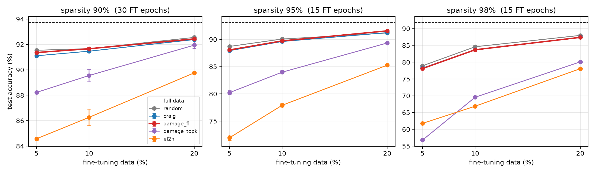

# Data-Efficient Recovery after Pruning via Coreset Selection

CS 260D (Large-Scale ML, Fall 2026) final project.

**Phase-1 experiment audit:** new runs should follow [COLAB_RUN_GUIDE.md](COLAB_RUN_GUIDE.md)
on `fix/experiment-audit`. [EXPERIMENT_AUDIT.md](EXPERIMENT_AUDIT.md) documents versioned
identities, append-only recovery, metadata and timing semantics. Existing CSVs, figures
and accuracy claims below are historical exports, not newly measured audit results.
The original launcher is preserved as `notebooks/colab_run_legacy.ipynb`; the active
Notebook uses the audit code, requires an existing checkpoint and disables historical
large grids by default. Legacy JSONL cannot skip v2 runs, and v2 selection timing is
not directly comparable with historical selection timing. Run the CPU checks with
`python -m unittest discover -s tests -v` and `python scripts/build_notebook.py --check`.

**Question:** after magnitude pruning, the network must be fine-tuned to recover accuracy.
How much of the training set does that fine-tuning really need, and which samples should we pick?

Pipeline: dense ResNet-18 (CIFAR-10, 93.67%) → global magnitude pruning (accuracy drops to 10%)
→ select a class-balanced subset of the training data (5–20%) → fine-tune on the subset only → test accuracy.

| method | idea |
|---|---|
| `full` | fine-tune on 100% of the data (upper bound) |
| `random` | class-balanced random subset (key baseline) |
| `el2n` | hardest samples for the pruned model, ‖softmax − onehot‖ |
| `craig` | CRAIG: facility location on last-layer gradients, weighted by cluster size |
| `damage_topk` | samples whose loss increased most due to pruning |
| `damage_fl` | **ours**: CRAIG objective where each sample's coverage is weighted by `alpha + damage_i / mean(damage)` |

## Experiments (343 runs)

| part | grid | runs |
|---|---|---|
| Main | sparsity {90, 95, 98}% × 5 methods × fraction {5, 10, 20}% + full data, 3 seeds, 30 epochs | 144 |
| Training budget | same grid at 15 epochs, sparsity {95, 98}% | 96 |
| Re-selection (extra) | subset re-chosen every 5 epochs: sparsity {90, 95, 98}% × {random, craig, damage_fl} × {5, 10, 20}%, 3 seeds, 30 epochs | 81 |
| Weight diagnostics (extra) | 4 re-selection runs that log how skewed the CRAIG weights are at each selection | 4 |
| Equal compute (extra) | full data for 6 / 3 epochs (same SGD steps as a 20% / 10% subset for 30 epochs), 3 sparsities, 3 seeds | 18 |

Fine-tuning: SGD (lr 0.01, momentum 0.9, wd 5e-4), batch 128, cosine schedule, random crop + flip.
Full-data runs use the same number of epochs, i.e. about 5× more steps than the 20% subsets.

## Results

**In short:** when only a small subset of the data can be used, coverage matters more than difficulty,
and class-balanced random selection re-drawn every few epochs is the best strategy we tested.
Subset selection does not save compute, though: with the same number of SGD steps, fine-tuning on
all the data for fewer epochs beats every subset strategy.



Test accuracy (%) with 20% of the data, 30 epochs, mean of 3 seeds:

| sparsity | full data, 30 ep | full data, 6 ep (same steps) | random | craig | damage_fl (ours) | random, re-selected every 5 ep |
|---|---|---|---|---|---|---|
| 90% | 93.73 | **93.22** | 92.55 | 92.38 | 92.43 | 93.03 |
| 95% | 93.43 | **92.65** | 91.26 | 91.29 | 91.72 | 92.37 |
| 98% | 92.36 | **90.83** | 88.32 | 87.99 | 88.24 | 90.37 |

- **Little data is enough:** 20% of the data comes within 1.2–4.0 points of full-data fine-tuning
  with the same number of epochs (1/5 of the steps).
- **Hard samples fail:** EL2N and damage_topk fall 20+ points behind random at 98% sparsity, 5% data.
- **Ours vs CRAIG vs random:** damage_fl ≥ CRAIG in 8 of 9 settings, but random is best in 7 of 9;
  damage_fl wins clearly only at 95% sparsity, 20% data (+0.46).
- **Re-selection (extra):** re-drawing random every 5 epochs beats every one-shot method in all 9 settings.
  Re-selected CRAIG / damage_fl usually improve too, but are unstable (15 of 54 runs collapse): CRAIG's
  cluster-size weights grow to 100–450× the mean once most samples are learned
  ([diagnostics](results/reselect_diag.csv)). [CREST](https://github.com/YuYang0901/CREST) avoids this
  by selecting only unlearned examples in small random pools and re-selecting often.
- **Equal compute (extra):** full data for 6 epochs (same steps as 20% × 30 epochs) beats the best
  one-shot subset by 0.7–2.5 points and random re-selection by 0.2–0.5; even 3 epochs (half the steps)
  beats the best one-shot 20% subset. So subsets help when the *data* is limited, not to save compute
  ([equal_compute_full.csv](results/equal_compute_full.csv)).
- **Limits:** one model and dataset, last-layer gradient proxy, alpha = 1 only, no CREST implementation.

Per-run numbers are in [`results/`](results/) (`all_runs.csv`, `reselect_runs.csv`, `reselect_diag.csv`, `equal_compute_full.csv`);
details and analysis are in the report.

## Quick start (Colab)

Open [`notebooks/colab_run.ipynb`](notebooks/colab_run.ipynb) in Colab
(File → Open notebook → GitHub → `liuyihao4fun/cs260d-pruning-coreset`) and run the cells top to bottom.
Checkpoints and results are written to Google Drive (`MyDrive/cs260d/`).
Sections 6–8 of the notebook run the re-selection grid, the weight diagnostics and the equal-compute baseline.

The notebook embeds a copy of `src/`, so Colab needs no GitHub token. **After changing anything in
`src/`, run `python scripts/build_notebook.py` and commit the regenerated notebook too.**

## Command line

```bash
pip install -r requirements.txt

# 1. dense model (once)
python -m src.train_dense --epochs 40 --out checkpoints/resnet18_cifar10.pt

# 2. one experiment
python -m src.finetune --ckpt checkpoints/resnet18_cifar10.pt --sparsity 0.9 --method craig --frac 0.1

# 3. a grid (resumable; --shard/--num_shards split it across teammates)
python -m src.run_grid --ckpt checkpoints/resnet18_cifar10.pt --sparsities 0.9 \
    --methods full random craig el2n damage_fl --fracs 0.05 0.1 0.2 --seeds 0 1 2

# 3b. the re-selection grid (any extra flag is passed through to finetune)
python -m src.run_grid --ckpt checkpoints/resnet18_cifar10.pt --sparsities 0.9 0.95 0.98 \
    --methods random craig damage_fl --fracs 0.05 0.1 0.2 --seeds 0 1 2 --epochs 30 --reselect_every 5

# 4. table + figure
python -m src.plot --results results/results.jsonl --out results/
python scripts/plot_reselect.py      # re-selection figures from the CSVs in results/
```

Debug on a laptop (CPU, tiny data): add `--limit_train 2000 --epochs 1`.

## Layout

```
src/
  data.py         CIFAR kept on the GPU + batched GPU augmentation (fast on Colab's 2 CPUs)
  models.py       ResNet-18 for 32x32 inputs
  prune.py        global magnitude pruning (torch.nn.utils.prune)
  train_dense.py  train the starting model
  finetune.py     prune -> select (optionally re-select) -> fine-tune -> evaluate; one JSON line per run,
                  including per-selection weight statistics (sel_stats)
  run_grid.py     grid runner, skips finished runs, supports sharding
  plot.py         summary.csv + acc_vs_frac.png
  selection/      one file per method; add new ones to METHODS in __init__.py
scripts/
  build_notebook.py   regenerates the Colab notebook from src/
  plot_reselect.py    re-selection figures and summary
notebooks/colab_run.ipynb   Colab launcher
results/
  all_runs.csv, summary_all.csv        main + training-budget runs (per seed / mean ± std)
  acc_vs_frac.png, gap_to_random.png, epochs_15_vs_30.png
  reselect_runs.csv, reselect_summary.csv, reselect_curves.csv, reselect_*.png
  reselect_diag.csv                    CRAIG weight skew at each re-selection
  equal_compute_full.csv               full data for 6 / 3 epochs (equal-step baseline)
```

The raw per-run JSON lines (with full accuracy curves) live on Google Drive; the CSVs here are exports.

## Team conventions
- Model weights and datasets never go into git (`.gitignore`); keep them on Drive.
- Each teammate writes to their own results file (`results_<name>.jsonl`); `plot.py` merges them.
- Pull before you push; keep commits small.
